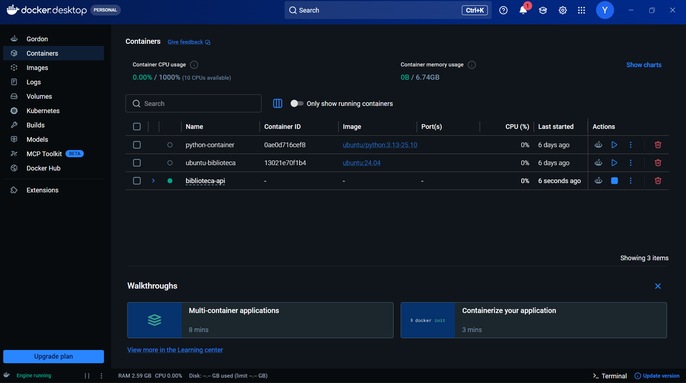
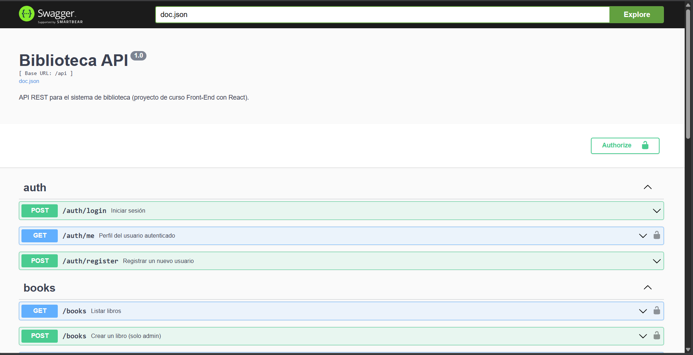

# Taller del segundo corte: práctica con Docker

**Asignatura:** Arquitectura de Software  
**Estudiante:** Carlos Antonio Ramírez Galvis  
**Proyecto:** Biblioteca API (Go + Gin + MySQL)  
**Fecha de ejecución final:** 13 de octubre de 2026

---

## Introducción

El objetivo de esta práctica fue ejecutar el proyecto `biblioteca-api` siguiendo la guía suministrada en el repositorio del curso. El sistema es una API REST escrita en Go, organizada con una arquitectura por capas (`handler` → `service` → `repository`), que utiliza MySQL como base de datos y JWT para la autenticación.

La práctica se realizó en Windows con Docker Desktop. Se obtuvo el código, se revisaron los archivos relacionados con Docker, se preparó la configuración, se construyeron y levantaron los servicios y se probó el flujo `register` → `login` → `books`. Todas las salidas completas están en la carpeta `evidencias/`. En el documento solo incluyo los fragmentos necesarios para explicar lo realizado.

## Fase 1. Preparación del entorno

### 1.1 Obtención del código

Se clonó el repositorio indicado por el profesor y se trabajó sobre el commit `7706425c7980355067f603868ec662f4058ff053`:

```powershell
git clone https://github.com/carrenoutb/biblioteca-api.git
cd biblioteca-api
```

### 1.2 Verificación de Docker

Antes de levantar los servicios se comprobaron las herramientas instaladas. La salida real fue:

```text
Docker version 29.8.2, build 7fc2dff
Docker Compose version v5.5.1
git version 2.55.0.windows.4
```

La evidencia completa se encuentra en `evidencias/01-versiones.txt`. También se verificó visualmente que Docker Desktop mostrara **Engine running**.



## Fase 2. Comprensión de las piezas del proyecto

### Dockerfile

El Dockerfile usa una construcción *multi-stage*. La primera etapa parte de `golang:1.26-alpine`, descarga los módulos y compila el binario `biblioteca-api`. La segunda etapa copia únicamente el binario y la carpeta de documentación Swagger a otra imagen. Esto separa el entorno de compilación del de ejecución y evita incluir archivos innecesarios en la imagen final.

La relación con la teoría es directa: el Dockerfile es la receta, `docker build` produce la imagen y Compose crea el contenedor de la API a partir de esa imagen.

### docker-compose.yml

El archivo Compose define dos servicios:

- `mysql`: utiliza `mysql:8.0`, publica el puerto 3306, monta el volumen `mysql_data`, carga la carpeta `migrations/` y ejecuta un *healthcheck*.
- `api`: se construye desde el Dockerfile, publica el puerto 8080, lee `.env` y depende de que MySQL esté saludable.

Compose también crea una red interna. Gracias a ella, la API encuentra la base de datos con el nombre `mysql` en lugar de usar una dirección IP fija.

### .env.example y .env

Se creó el archivo local `.env` a partir de `.env.example` con el comando indicado en la guía:

```powershell
cp .env.example .env
```

En PowerShell, `cp` es un alias de `Copy-Item`. El comando no muestra texto cuando termina correctamente, por lo que después se comprobó que el archivo existiera y que contuviera las ocho variables esperadas. No se publica el secreto ni la contraseña en las evidencias. Las variables se interpretaron así:

| Variable | Función |
|---|---|
| `DB_HOST=mysql` | Nombre DNS del servicio MySQL dentro de la red de Compose. |
| `DB_PORT=3306` | Puerto interno de MySQL. |
| `DB_USER=biblioteca_user` | Usuario con el que la API se conecta a la base. |
| `DB_PASSWORD` | Contraseña que debe coincidir con la configurada para MySQL. |
| `DB_NAME=biblioteca` | Nombre de la base de datos del sistema. |
| `JWT_SECRET` | Clave usada para firmar los tokens JWT. |
| `JWT_EXPIRATION_HOURS=24` | Tiempo de vigencia de los tokens. |
| `APP_PORT=8080` | Puerto en el que escucha la API. |

La configuración comprobada, con los valores sensibles ocultos, quedó registrada en `evidencias/02-configuracion-env.txt`. En el log de la API aparece el mensaje `No se encontró archivo .env`; esto no significa que faltara la configuración. Compose leyó el archivo mediante `env_file` e inyectó sus variables al contenedor, por lo que no era necesario copiar el archivo `.env` dentro de la imagen.

### migrations/

La migración `001_init.sql` configura UTF-8, crea las tablas `users`, `books` y `loans`, establece las relaciones y carga seis libros de ejemplo. MySQL ejecuta este archivo automáticamente cuando inicializa un volumen vacío.

Durante la revisión se encontró un error real en el `INSERT`: la fila de *The Pragmatic Programmer* terminaba en punto y coma aunque todavía faltaba otro libro. Se cambió ese punto y coma por una coma para que las seis filas pertenecieran a la misma sentencia SQL. Sin esa corrección, la inicialización de una base nueva podía fallar al encontrar una tupla aislada.

## Fase 3. Construcción y puesta en marcha

El conjunto se levantó con:

```powershell
docker compose up --build -d
```

Se agregó `-d` para dejar los servicios ejecutándose en segundo plano mientras se hacían las verificaciones, opción que también explica el README. Docker construyó la imagen `biblioteca-api-api`, creó la red y el volumen y arrancó los dos contenedores. La salida de construcción está en `evidencias/04-compose-up-build.txt`. Algunas capas aparecen como `CACHED` porque la descarga y construcción inicial se hizo el 10 de octubre; al repetir la prueba después de encender nuevamente el computador, Docker reutilizó esas capas en lugar de descargarlas otra vez.

Se presentó una advertencia porque el repositorio incluía `version: "3.9"`. En las versiones actuales de Compose ese atributo está obsoleto y se ignora. Se eliminó la línea; no era necesaria para definir los servicios.

Después del arranque, `docker compose ps` mostró:

```text
NAME               SERVICE   STATUS
biblioteca_api     api       Up
biblioteca_mysql   mysql     Up (healthy)
```

Los puertos quedaron publicados como `8080:8080` para la API y `3306:3306` para MySQL. En la columna `CREATED` aparece `2 days ago` porque los contenedores se habían creado en la primera ejecución del 10 de octubre y Docker los conservó; después de reiniciar el computador se pusieron en marcha nuevamente el 13 de octubre. La salida completa está en `evidencias/06-compose-ps.txt` y `evidencias/15-estado-final.txt`.

### Observación del orden de arranque

Los logs permitieron ver algo que no era tan evidente en el diagrama. El *healthcheck* de MySQL llegó a responder mientras el proceso de inicialización todavía terminaba de preparar la base. La API realizó dos intentos de conexión fallidos y luego se conectó correctamente:

```text
Intento 1/10: no se pudo conectar a MySQL
Intento 2/10: no se pudo conectar a MySQL
Conexión a MySQL establecida correctamente
Servidor escuchando en el puerto 8080
```

Esto demuestra por qué, además de `depends_on`, la aplicación implementa reintentos. El log completo de inicialización de MySQL está en `evidencias/07-logs-mysql.txt` y el extracto relevante de la API está en `evidencias/08-logs-api.txt`.

## Fase 4. Verificación funcional

Las peticiones se ejecutaron desde PowerShell con `Invoke-RestMethod`, que cumple la misma función de cliente HTTP que `curl`: permite escoger el método, enviar JSON, agregar la cabecera `Authorization` y observar la respuesta real de la API.

### 4.1 Estado de la API

Se consultó `GET http://localhost:8080/health`. Respondió en el primer intento una vez que la API terminó de iniciar:

```json
{
  "status": "ok"
}
```

Evidencias: `evidencias/09-health-espera.txt` y `evidencias/09-health.json`.

### 4.2 Registro de usuario

Se envió un `POST` a `/api/auth/register` con un usuario de práctica. La API creó el usuario con rol `student` y devolvió un JWT. El token completo se ocultó antes de guardar la evidencia:

```json
{
  "resultado": "usuario registrado correctamente",
  "user": {
    "id": 1,
    "name": "estudiante-taller",
    "email": "taller-practica@example.com",
    "role": "student"
  }
}
```

Evidencia: `evidencias/10-register.json`.

### 4.3 Inicio de sesión

Luego se envió el mismo correo y contraseña a `/api/auth/login`. La API autenticó al usuario y entregó un token nuevo:

```json
{
  "resultado": "inicio de sesion correcto",
  "token_recibido": "eyJhbGciOiJIUzI1NiIs...[OCULTO]"
}
```

Evidencia: `evidencias/11-login.json`.

### 4.4 Consulta de libros usando el token

El JWT del login se envió en la cabecera `Authorization: Bearer ...` al consultar `GET /api/books`. La respuesta contuvo los seis registros cargados por la migración, entre ellos *Cien años de soledad*, *Clean Code*, *El principito*, *Sapiens*, *The Pragmatic Programmer* y *The Go Programming Language*.

Este resultado prueba al mismo tiempo que la autenticación funciona, que la API se comunica con MySQL y que la migración cargó los datos. La respuesta completa está en `evidencias/12-books.json`.

### 4.5 Swagger

Se comprobó la ruta `http://localhost:8080/swagger/index.html`. El servidor respondió:

```text
HTTP 200 OK
Content-Type: text/html; charset=utf-8
Bytes recibidos: 3728
```

La comprobación técnica está en `evidencias/13-swagger.txt`. También se abrió la interfaz web y se verificó que aparecieran los grupos de operaciones `auth` y `books`.



## Preguntas de comprensión

### 1. ¿Qué diferencia hay entre una imagen y un contenedor? Use un ejemplo del proyecto.

Una imagen es una plantilla de solo lectura que contiene archivos, binarios y configuración. Un contenedor es una instancia de esa imagen que tiene procesos en ejecución, red y una capa escribible. En este proyecto, `mysql:8.0` es la imagen descargada y `biblioteca_mysql` es el contenedor creado a partir de ella. Para la API, el Dockerfile produce la imagen `biblioteca-api-api` y Compose crea `biblioteca_api`. Si se elimina un contenedor, la imagen puede seguir disponible para crear otro.

### 2. ¿Qué hace Docker Compose que no haría con `docker run` por separado?

Compose describe el sistema completo en un solo archivo: servicios, variables, puertos, volumen, red, dependencia y *healthcheck*. Con varios `docker run` habría que crear y coordinar manualmente cada elemento, procurando que todos los nombres coincidan. Compose también permite administrar el conjunto como una unidad mediante `up`, `ps`, `logs` y `down`.

### 3. ¿Por qué la API encuentra la base con `DB_HOST=mysql` y no con `127.0.0.1`?

Dentro del contenedor de la API, `127.0.0.1` apunta al propio contenedor de la API. MySQL es otro contenedor. Compose crea una red y registra el nombre de cada servicio en un DNS interno; por eso `mysql` se resuelve a la dirección correcta del contenedor de base de datos, aunque esa dirección cambie al recrearlo.

### 4. ¿Qué borra `docker compose down -v` y cuándo se usaría?

`docker compose down` detiene y elimina los contenedores y la red del proyecto. La opción `-v` también borra el volumen `mysql_data`, donde se guardan los datos de MySQL. No borra el código fuente. Lo usaría para reiniciar la base desde cero y volver a ejecutar la migración, pero no si necesito conservar usuarios, libros modificados o préstamos. En esta práctica no fue necesario ejecutarlo al final porque se conservaron los datos y contenedores como evidencia.

### 5. ¿Qué ocurre si cambia `DB_PASSWORD` en `.env`, pero no en Compose? ¿Y al revés?

`MYSQL_PASSWORD` en Compose configura la contraseña del usuario dentro de MySQL durante la inicialización. `DB_PASSWORD` en `.env` es la contraseña que presenta la API al conectarse. Si solo cambia uno de los valores, las credenciales no coinciden y la API no puede autenticarse. Además, cambiar la variable de MySQL después de creado el volumen no modifica automáticamente un usuario existente. Habría que actualizar la contraseña dentro de la base o recrear conscientemente el volumen, sabiendo que esto elimina los datos.

## Problemas encontrados y soluciones

### 1. Cliente instalado, pero motor no iniciado

Al principio `docker --version` funcionaba, pero Compose no podía conectarse a `dockerDesktopLinuxEngine`. Esto ocurrió porque el cliente estaba instalado, pero Docker Desktop no estaba ejecutándose. Se abrió Docker Desktop y se esperó hasta ver **Engine running**.

### 2. Atributo `version` obsoleto

Compose advirtió que `version: "3.9"` sería ignorado. Se eliminó esa línea porque Compose actual detecta automáticamente el formato del archivo.

### 3. Error de sintaxis en la migración

El punto y coma antes del último libro cerraba el `INSERT` antes de tiempo. Se reemplazó por una coma para cargar correctamente las seis filas.

### 4. La API todavía no estaba lista al primer intento

Aunque el contenedor figuraba como `running`, la aplicación aún estaba esperando a que MySQL terminara su inicialización. Se revisaron los logs y se dejó que los reintentos de conexión de la API completaran el arranque. Después `/health` respondió `ok`.

## Conclusión

La práctica permitió comprobar que Docker no es solamente una forma distinta de instalar programas. El valor principal fue poder describir y arrancar una solución completa: la imagen propia de la API, una imagen pública de MySQL, una red, un volumen y las variables necesarias. Compose hizo posible administrar esas piezas con un solo comando.

También fue importante encontrar problemas reales. Un contenedor en estado `running` no garantiza inmediatamente que la aplicación esté lista para recibir solicitudes, y un *healthcheck* debe interpretarse junto con los logs. La ejecución final confirmó el flujo completo: MySQL quedó saludable, la API respondió en el puerto 8080, el registro y el login generaron tokens y la consulta autenticada devolvió los libros de la base. Esto conecta la teoría de imágenes y contenedores con una arquitectura por capas funcionando de manera concreta.

## Relación de evidencias

| Evidencia | Contenido |
|---|---|
| `00-resumen.txt` | Fechas, duración y resultado general. |
| `01-versiones.txt` | Versiones de Docker, Compose y Git. |
| `02-configuracion-env.txt` | Variables verificadas con secretos ocultos. |
| `04-compose-up-build.txt` | Construcción y arranque de los servicios. |
| `05-espera-servicios.txt` | Verificación de estados internos. |
| `06-compose-ps.txt` | Estado y puertos de los contenedores. |
| `07-logs-mysql.txt` | Inicialización de MySQL. |
| `08-logs-api.txt` | Extracto de reintentos, conexión y rutas de la API. |
| `09-health-espera.txt` y `09-health.json` | Respuesta del endpoint de salud. |
| `10-register.json` | Registro del estudiante de prueba. |
| `11-login.json` | Inicio de sesión y token oculto. |
| `12-books.json` | Lista autenticada de seis libros. |
| `13-swagger.txt` | Respuesta HTTP de Swagger. |
| `14-imagenes.txt` | Imágenes disponibles después de la construcción. |
| `15-estado-final.txt` | Estado final de API y MySQL. |
| `16-docker-desktop-running.png` | Docker Desktop con el motor activo. |
| `17-swagger-ui.png` | Interfaz Swagger con las operaciones de la API. |

